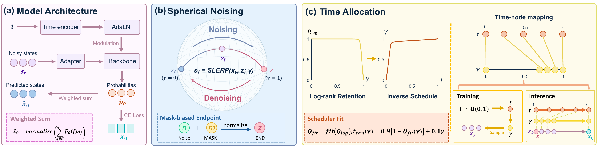

# LLaCO: Continuous Diffusion for Large Language Models with Competition-Aware Semantic Scheduling

Zijian Jia\*,
Peixuan Zhang\*,
Genying Li,
Di Wu,
Yujie Fu,
Si Li,
Boxin Shi,
Shuchen Weng

\*Equal contribution

## Abstract

**LLaCO** is a continuous diffusion framework for large language models, powered by Competition-Aware Semantic Scheduling.

CLICK for the full abstract

Continuous diffusion models have emerged as a promising non-autoregressive paradigm for text generation, enabling bidirectional contextual planning and fine-grained semantic transitions over continuous embedding spaces. Along the continuous trajectory, the residual token identity in an intermediate state directly shapes the denoising objective at each step. However, the geometric trajectory strictly misaligns with temporal progression, triggering severe temporal compression near the noisy endpoint. In this paper, we show that embedding norm decay causes Euclidean distance to yield spurious overtaking, indicating that token competition must be evaluated directionally. In this space, a candidate overtakes the source token only when the effective noise magnitude surpasses their semantic separation. We formalize these pairwise dynamics as the Competition Threshold Theory (CTT). Crucially, high-dimensional overtaking requires extreme noise levels, causing standard trajectories to concentrate identity decay into a narrow window near the noisy endpoint. To resolve this, we propose Semantic Retention Scheduling (SRS) to align time allocation with the progression of identity decay, and demonstrate that existing token identity metrics are fundamentally statistical aggregations of these pairwise crossings. Building on these theoretical insights, we introduce LLaCO, a generative framework powered by competition-aware semantic scheduling. LLaCO adapts a pretrained backbone to continuous representations via an embedding directional adapter and timestep-conditioned modulation. To operate within the directional space, LLaCO employs a spherical noising process formulated as a geodesic interpolation toward a mask-biased endpoint, eliminating norm decay while preserving accurate token competition. Guided by SRS, LLaCO reallocates the denoising trajectory proportionally to the logarithmic rank decay, dedicating maximum optimization budget to critical identity transitions. Instantiated as an 8B model, LLaCO comprehensively outperforms previous continuous diffusion baselines across extensive benchmarks and rivals discrete diffusion models of comparable scale, laying a principled foundation for future exploration.

## 💡 News
- 2026.10.23 Release Project Page and Technical Report!

## 📑 Todo List

- [ ] Release inference code
- [ ] Release LLaCO-8B checkpoint
- [ ] Release training code

## 📥 Download

Coming soon.

## 🛠️ Installation

Coming soon.

## 🚀 Inference

Coming soon.

## Citation

Coming soon.
